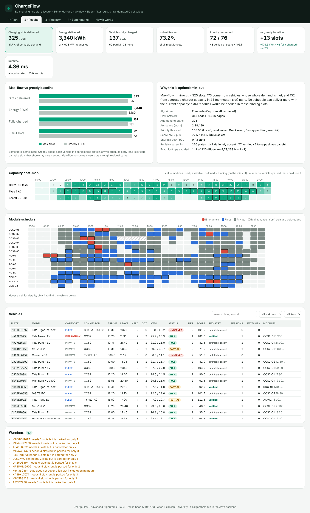

# ChargeFlow: EV charging hub slot allocator

**Advanced Algorithms · CIA-3 Real-World Application Project · Semester V, B.Tech CS (AI & ML)**
Daksh Shah · App ID 2405709 · Atlas SkillTech University · individual submission (faculty-approved)

ChargeFlow decides **which electric vehicle charges on which charging module in every 30-minute slot** at a busy urban charging hub. On a peak day more cars arrive than the hub can fully charge. ChargeFlow schedules the hub so that it:

1. delivers the **maximum possible charging (kWh)** with the modules it has,
2. **protects a priority tier** (emergency vehicles, fleets with SLAs, low-battery and tight-deadline cars), and
3. **explains the bottleneck**: which connector types and time slots limit the hub (min-cut), so the operator knows where an extra module would help.

| Technique (syllabus unit) | Role in the app | Code |
|---|---|---|
| **Edmonds–Karp max-flow + min-cut** (Unit 5, CO4) | Core scheduler: `source → vehicle → (connector, slot) → sink`, solved in priority tiers; the min-cut certifies optimality | `algo/flow/EdmondsKarp.java`, `MinCut.java`, `engine/AllocationEngine.java` |
| **Bloom filter** (Unit 6, CO5) | Screens every plate against a 50,000-plate subscriber registry; hits are **always** confirmed by an exact lookup | `algo/bloom/BloomFilter.java`, `service/RegistryService.java` |
| **Randomized Quickselect** (Unit 6, CO5) | Finds the k-th highest priority score in expected O(n) to form the priority tier; p50/p90 statistics | `algo/select/RandomizedQuickselect.java`, `engine/PriorityTiering.java` |
| Baselines | Greedy FCFS allocator, Ford–Fulkerson (DFS), first-pivot Quickselect, sort-based selection, HashSet | `engine/AllocationEngine.greedy`, `FordFulkersonDfs`, `NaiveQuickselect` |

All assessed algorithms are written from scratch in Java (no library graph, Bloom or selection code). Spring Boot provides only HTTP and JSON. The browser only collects input and draws results.



---

## 1. Prerequisites

| Tool | Version | Check |
|---|---|---|
| JDK | **17 or newer** (tested on 21) | `java -version` |
| Maven | not needed: the bundled wrapper `./mvnw` downloads Maven 3.9 on first run | — |
| Browser | any modern browser | — |
| Python 3 + matplotlib | optional, only to regenerate report charts | — |

macOS: `brew install openjdk@21` (or install Temurin 21 from adoptium.net). No database and no environment variables are needed. No secrets are used.

## 2. Build, test, run

```bash
cd ChargeFlow
./mvnw test                 # 60 JUnit tests (algorithms, engine, validation, REST API)
./mvnw spring-boot:run      # starts the backend and frontend on http://localhost:8080
```
Windows: use `mvnw.cmd` in place of `./mvnw`. To use another port: `PORT=9090 ./mvnw spring-boot:run`.

Packaged jar:
```bash
./mvnw -q package -DskipTests
java -jar target/chargeflow-1.0.0.jar
```

Full benchmark suite (writes `benchmarks/results.csv` and `benchmarks/results.md`, about 1–2 minutes):
```bash
./mvnw -q compile exec:java                 # full sizes
./mvnw -q compile exec:java -Dexec.args=quick
python3 docs/make_charts.py                 # optional: regenerate docs/img/*.png
```

## 3. Using the app (demo script)

1. **Plan tab:** the default hub (Baner EV Hub, Pune: 6× CCS2 60 kW, 5× Type 2 AC 7.4 kW, 3× Bharat DC-001 15 kW, 06:00–22:00, CCS2-03 under maintenance 12:00–14:00) and a synthetic 220-vehicle day are loaded on start-up. Edit module counts, power ratings, maintenance windows or slot length, or upload your own CSV.
2. Pick the **algorithm** (Edmonds–Karp, Ford–Fulkerson DFS, or the Greedy baseline), the **priority tier size** (0–60%) and the Quickselect seed, then press **Run allocation**.
3. **Results tab:** KPIs, max-flow vs greedy bars, the min-cut explanation, a capacity heat-map (binding cells outlined), a per-module schedule (Gantt) and a filterable per-vehicle table with registry status, tier, score, sessions and module switches.
4. **Registry tab:** Bloom filter parameters (n, m, k, memory, theoretical FPR), a live plate check that shows the Bloom answer and the exact answer separately, a rebuild option with a different target FPR, and an empirical-vs-theoretical FPR experiment.
5. **Benchmarks tab:** quick live benchmarks with log–log charts.
6. Edge cases for the viva: *Load sample → Invalid rows* then **Run** (6 problems reported, nothing computed); *Load sample → Hand-check* with Priority tier at **0%**: Greedy gives 5 slots, Edmonds–Karp gives 7 (see §6); set every module count of a type to 0 (its vehicles become INFEASIBLE with a warning); set all counts to 0 (rejected as an infeasible network).

## 4. Input data

### Vehicle CSV
```
plate,model,connector,arrival,departure,energy_kwh,battery_pct,max_charge_kw,category
MH12AB1234,Tata Nexon EV,CCS2,09:00,10:30,22,30,50,PRIVATE
```
| column | rule |
|---|---|
| plate | Indian registration (`MH12AB1234`, `DL3CAF0001`) or BH series (`22BH1234AA`); spaces and dashes are normalised; duplicates are rejected |
| connector | `CCS2`, `TYPE2_AC`, `BHARAT_DC001` |
| arrival, departure | `HH:mm`, departure > arrival, same day |
| energy_kwh | (0, 200] |
| battery_pct | [0, 100] |
| max_charge_kw | optional; effective power = min(charger rating, vehicle max) |
| category | `EMERGENCY`, `FLEET`, `PRIVATE` (default) |

### Sample data (`sample-data/`)
| file | content |
|---|---|
| `hub_default.json` | default hub (also `GET /api/hub/default`) |
| `vehicles_demo_220.csv` | realistic synthetic peak day, seed 2026 |
| `vehicles_stress_2000.csv` | 2,000 vehicles for an 8× hub (`SyntheticData.scaledHub(8)`) |
| `hub_small.json` + `vehicles_small.csv` | hand-checkable instance where greedy is sub-optimal |
| `vehicles_invalid.csv` | duplicate plate, bad plate, reversed window, bad energy and battery, bad time |
| `registry_plates.csv` | the 50,000 subscriber plates the server loads by default |

The synthetic generator (`data/SyntheticData.java`) is seeded and models a bimodal commuter arrival profile (morning and evening peaks plus a midday fleet plateau), lognormal dwell times, and the Indian EV mix (Nexon EV, Punch EV, ZS EV, XUV400, Tiago EV, Comet EV, Tigor EV fleet, …) with their real battery sizes and charge-rate limits.

### Assumptions
- A vehicle is parked for its whole window; the power cabinet switches modules between bays at slot boundaries (dynamic power sharing), so charging can be split into non-contiguous slots.
- Each slot delivers `effectiveKw × slotHours` kWh (no taper near 100% SoC). Slots needed = ⌈energy / (effectiveKw × slotHours)⌉, capped at the window length.
- A vehicle uses exactly one connector type at this hub.

### Failure cases handled
Empty dataset, more than 20,000 vehicles, malformed CSV/JSON, unknown connector, invalid or duplicate plate, reversed or malformed time window, out-of-range energy or battery, stays outside opening hours (kept as INFEASIBLE with a warning), connector type with no modules (INFEASIBLE + warning), a hub with no chargers (rejected as an infeasible network), invalid maintenance ranges, duplicate charger ids, invalid Bloom parameters, and invalid registry plates. Errors come back as `{status, error, details[]}`, with **all** problems listed.

## 5. REST API

| method | path | purpose |
|---|---|---|
| GET | `/api/health` | liveness |
| GET | `/api/hub/default` | default hub JSON |
| POST | `/api/hub/validate` | validate a hub |
| POST | `/api/vehicles/generate` | `{count, seed, registeredShare, hub}` → synthetic vehicles + CSV |
| POST | `/api/vehicles/parse` | CSV text (`text/plain`) → vehicles + per-line errors |
| POST | `/api/allocate` | `{hub, vehicles, options:{algorithm, priorityFraction, compareBaseline, seed}}` → full result |
| GET | `/api/registry` | Bloom/registry statistics |
| POST | `/api/registry/generate` | `{size, fpr, seed}` rebuild with synthetic plates |
| POST | `/api/registry/load` | `{plates:[…], fpr}` rebuild from your list |
| GET | `/api/registry/check?plate=` | Bloom answer + exact answer |
| GET | `/api/benchmark/{flow,selection,bloom,fpr}` | quick benchmarks |

```bash
curl -s localhost:8080/api/hub/default > hub.json
curl -s -X POST localhost:8080/api/vehicles/generate -H 'Content-Type: application/json' \
     -d '{"count":220,"seed":2026}' | python3 -c 'import json,sys; print(json.dumps(json.load(sys.stdin)["vehicles"]))' > v.json
python3 -c 'import json; print(json.dumps({"hub":json.load(open("hub.json")),"vehicles":json.load(open("v.json")),"options":{"algorithm":"EDMONDS_KARP","priorityFraction":0.2}}))' > req.json
curl -s -X POST localhost:8080/api/allocate -H 'Content-Type: application/json' -d @req.json | python3 -m json.tool | head -40
curl -s 'localhost:8080/api/registry/check?plate=MH12AB1234'
```

## 6. Hand-checkable example (`hub_small.json`, priority tier 0%)

One CCS2 module and one AC module, four one-hour slots (08–12).

| vehicle | window | needs | Greedy FCFS | Edmonds–Karp |
|---|---|---|---|---|
| …0001 Nexon | 08–12 | 2 | 08, 09 ✔ | 10 (1 of 2) |
| …0002 Punch | 08–09 | 1 | – ✘ | 08 ✔ |
| …0003 ZS EV | 09–10 | 1 | – ✘ | 09 ✔ |
| …0004 XUV400 | 10–12 | 1 | 10 ✔ | 11 ✔ |
| …0005 Tiago (AC) | 09–12 | 2 | 09, 10 ✔ | 10, 11 ✔ |
| …0006 Comet (AC) | 09–10 | 1 | – ✘ | 09 ✔ |
| …0007 Tigor (Bharat DC) | 08–11 | 2 | INFEASIBLE | INFEASIBLE |
| **total** | | | **5 slots, 3 full** | **7 slots, 5 full** (= min-cut 7) |

Capacity is 8 slots, but only 7 are reachable: the AC module at 08:00 has no AC vehicle parked.

## 7. Results summary (full numbers: `benchmarks/results.md`)

* **Quality:** max-flow serves **+5.4% to +6.8% more charging slots** than greedy FCFS at 250–4,000 vehicles (333 vs 313, 1,415 vs 1,343, 2,863 vs 2,710, 5,667 vs 5,308).
* **Edmonds–Karp vs DFS Ford–Fulkerson:** on the shallow, unit-capacity allocation network both are fast (paths have 3 arcs, so DFS is often cheaper). On deep random networks with capacities up to 10⁴, Edmonds–Karp needs about **2.8× fewer augmenting paths** and is **2.7–5.3× faster** (4,000 nodes: 41 ms vs 177 ms).
* **Randomized Quickselect:** **5.3× faster** than sort-then-index at 4M elements (58 ms vs 307 ms). On sorted input the first-pivot baseline goes quadratic (40k elements: 314 ms and 6×10⁸ comparisons vs 0.3 ms and 2.4×10⁵ for randomized).
* **Bloom filter:** 1M plates in **1.2 MB vs about 96 MB** for a HashSet. Empirical FPR 0.97%, 1.03% and 1.05% against a theoretical 1.00%, and zero false negatives. In-process, a HashSet query is faster; the Bloom filter wins when the authoritative registry is remote or too large to hold in memory, because it avoids about 65% of exact lookups (every non-subscriber).

## 8. Project layout
```
src/main/java/com/chargeflow/
  algo/flow/      FlowNetwork, EdmondsKarp, FordFulkersonDfs, MinCut, MaxFlowSolver
  algo/bloom/     BloomFilter (own hashing, double hashing, bit array)
  algo/select/    RandomizedQuickselect (3-way partition), NaiveQuickselect
  engine/         AllocationEngine (network build, tiered max-flow, greedy), PriorityTiering, ChargerAssigner
  service/        ValidationService, RegistryService, AllocationService
  api/            ChargeFlowController, ApiExceptionHandler
  data/           SyntheticData, VehicleCsv
  bench/          Benchmarks, BenchmarkCli
src/main/resources/static/   index.html, app.js, styles.css (frontend), samples/
src/test/java/...            60 JUnit tests
sample-data/  benchmarks/  docs/
```

## 9. Tests (`./mvnw test`)

| suite | tests | covers |
|---|---|---|
| `MaxFlowTest` | 18 | CLRS example, disconnected sink, zero/single edge, parallel and anti-parallel edges, reverse-arc cancellation, bipartite matching, invalid input, incremental resume, 10 random property checks (EK = FF, capacity, conservation, max-flow = min-cut) |
| `BloomFilterTest` | 7 | no false negatives, empty filter, sizing formula, empirical FPR within 25% of theory, invalid params, duplicate inserts, overfill |
| `QuickselectTest` | 11 | all k vs sort (5 seeds), k = 0 / n−1 / single element, all-equal input, invalid input, sorted adversary, non-destructive percentile, expected-linear work |
| `AllocationEngineTest` | 11 | greedy trap (hand-checked), demand > window, infeasible connector, maintenance, tier preservation, 5 random stress invariants, exact-k tiering |
| `ValidationAndRegistryTest` | 8 | empty, duplicates, multi-error report, no chargers, outside hours, CSV parsing, Bloom hits always verified, registry validation |
| `ApiIntegrationTest` | 5 | generate→allocate over HTTP, 422 on empty, 400 on bad JSON, registry check, CSV errors |

## 10. Limitations
* Max-flow maximises **slots (energy)**, not the **number of fully charged vehicles**. That objective is a knapsack-like NP-hard problem; it is reported, never claimed as optimised.
* Requiring contiguous charging sessions makes scheduling NP-hard; the power-sharing model avoids this, and the module assigner keeps sessions contiguous where it can.
* Single-day horizon, deterministic arrivals (no no-shows or stochastic arrivals), no charging taper.
* The authoritative registry is an in-memory HashSet standing in for an operator database.

Documentation: `docs/PROPOSAL.md` (deliverable A) and `docs/REPORT.md` (deliverable C).
