# ChargeFlow: Demonstration Evidence

**Advanced Algorithms · CIA-3 · Deliverable D**\
Daksh Shah · App ID 2405709 · Atlas SkillTech University · Repo: [github.com/makchd9/ChargeFlow](https://github.com/makchd9/ChargeFlow)

This document collects the four kinds of evidence deliverable D asks for: the working application, example inputs and outputs, error handling, and performance charts and tables. Every screen and response below was captured from the running application (Java backend + JavaScript frontend); every figure can be regenerated from the repository.

## 1. Working application (local)

The application runs locally with one command, `bash run.sh` (or `./mvnw spring-boot:run`), and serves the UI at `http://localhost:8080`. The screenshots below were taken on the student's MacBook (Safari with a dark-mode extension active; browser toolbar cropped) on 26 Nov 2026.

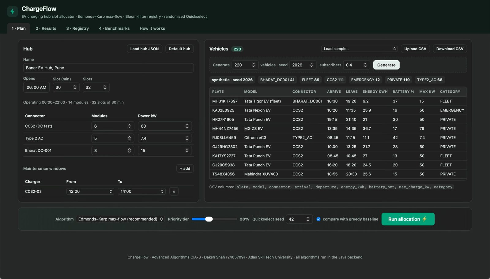

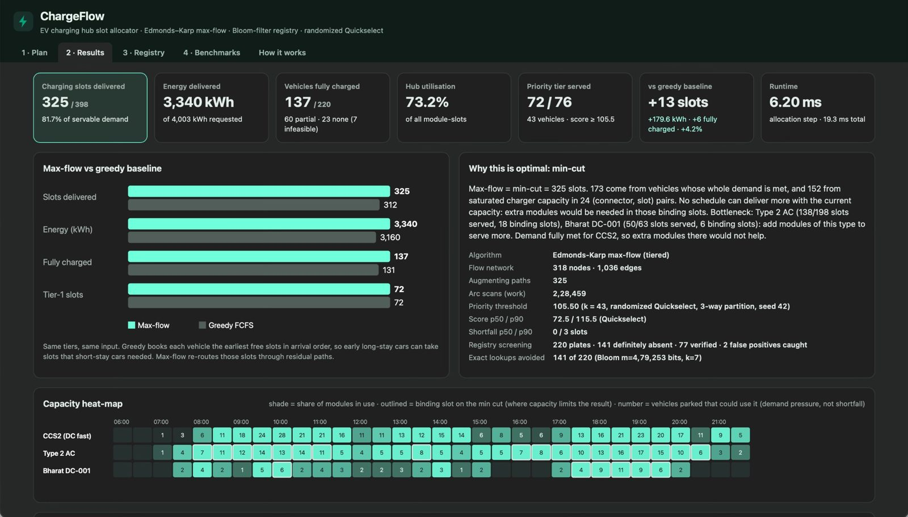

The same build passes all 64 JUnit tests (`./mvnw test`) on the developer machine and on a clean clone.

## 2. Example inputs and outputs

### 2.1 Demo day: 220 vehicles at the default hub

**Input:** Baner EV Hub, Pune (6× CCS2 60 kW, 5× Type 2 AC 7.4 kW, 3× Bharat DC-001 15 kW, 06:00–22:00 in 30-minute slots, CCS2-03 down 12:00–14:00) and 220 synthetic vehicles (seed 2026, file `sample-data/vehicles_demo_220.csv`). Options: Edmonds–Karp, 20% priority tier, Quickselect seed 42.

**Output** (screenshot in §1):

| Metric | Edmonds–Karp max-flow | Greedy FCFS baseline |
|---|---:|---:|
| Charging slots delivered (of 398 servable) | **325** | 312 |
| Energy delivered (of 4,003 kWh requested) | **3,340 kWh** | 3,160 kWh |
| Vehicles fully charged (of 220) | **137** | 131 |
| Priority-tier slots served (of 76) | 72 | 72 |
| Allocation time | ~4 ms | <1 ms |

Max-flow = min-cut = 325, so no feasible schedule can deliver more with this capacity. The min-cut also locates the bottleneck: all CCS2 demand is met (137/137 slots), while Type 2 AC (138/198) and Bharat DC-001 (50/63) are capacity-bound; adding two AC modules raises the optimum to 353. The Bloom filter screened 220 plates: 141 definitely absent (no database lookup), 77 verified subscribers, 2 false positives caught by the exact lookup.

### 2.2 Hand-checkable instance: where greedy fails

**Input:** `sample-data/hub_small.json` (1 CCS2 module, 1 AC module, four one-hour slots 08:00–12:00) and `sample-data/vehicles_small.csv` (7 vehicles), priority tier 0%.

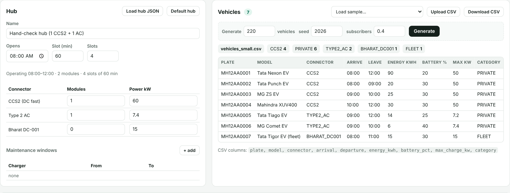

**Output, greedy FCFS baseline:** 5 slots, 3 vehicles fully charged.

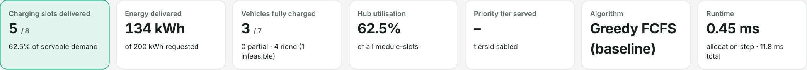

**Output, Edmonds–Karp:** 7 slots, 5 vehicles fully charged (= min-cut 7). Max-flow moves the long-stay Nexon (…0001) to 10:00 so that the short-stay Punch (…0002) and ZS EV (…0003) both charge.

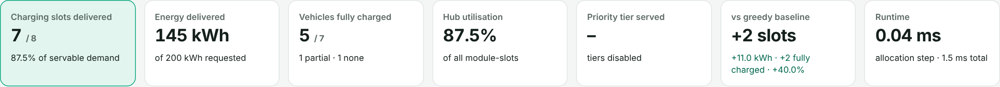

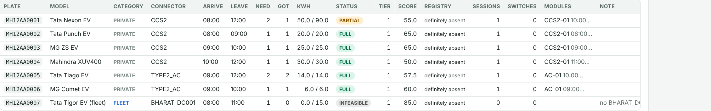

The Tigor (…0007) needs a Bharat DC-001 connector that this hub does not have; it is reported as **INFEASIBLE** rather than silently dropped.

### 2.3 Registry screening (Bloom filter + exact verification)

A registered plate is reported as *possibly present* by the Bloom filter and then **verified** by the exact store. An unregistered plate that happens to hit all k bits is a Bloom **false positive**; the exact lookup catches it, and no benefit is granted.

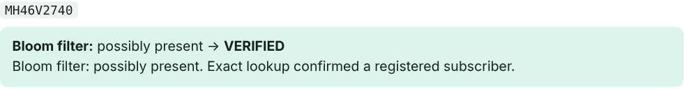

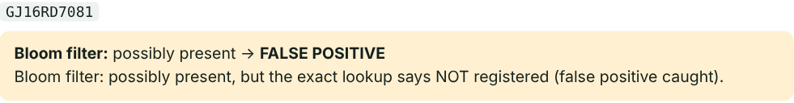

## 3. Error handling

Invalid input is never silently accepted. Every response below is real output from the running server.

**3.1 Invalid vehicle file** (`sample-data/vehicles_invalid.csv`, 6 rows): all problems are reported together, and nothing is computed (HTTP 422).

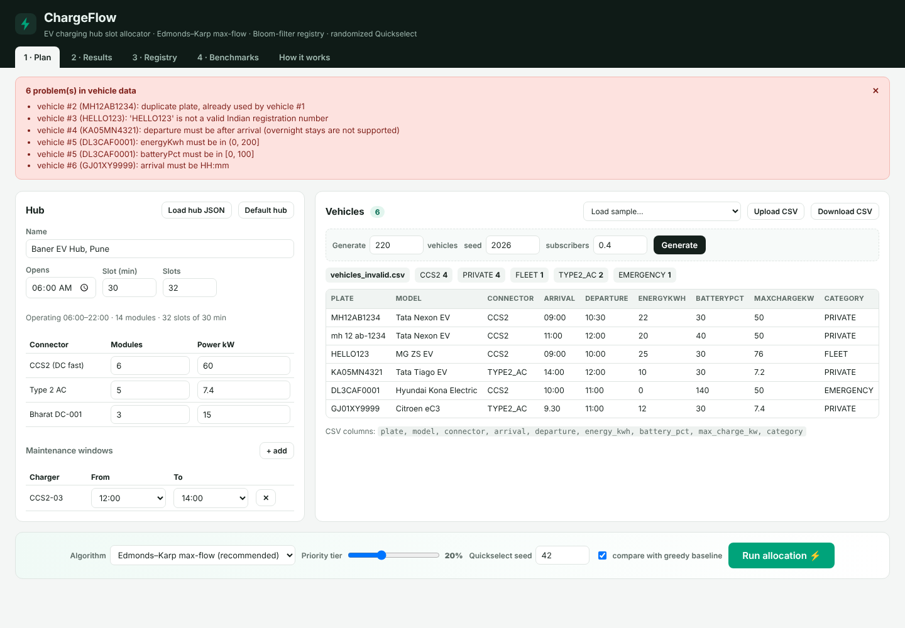

**3.2 Empty dataset** (HTTP 422):

```json
{"status":422,"error":"No vehicles supplied: upload a CSV or generate a sample dataset first","details":[]}
```

**3.3 Infeasible network: hub with no chargers** (HTTP 422):

```json
{"status":422,"error":"Invalid hub configuration","details":["hub has no chargers, so no vehicle can be served (infeasible network)"]}
```

**3.4 Malformed request body** (HTTP 400):

```json
{"status":400,"error":"Malformed JSON request","details":["Unexpected character ('n' (code 110)): was expecting double-quote to start field name ..."]}
```

**3.5 Bad CSV values:** each bad line is reported with its line number, and no partial import happens:

```json
{"vehicles":[],"errors":["line 2: unknown connector 'CCS9' (expected CCS2, TYPE2_AC or BHARAT_DC001)",
                         "line 3: energy_kwh 'abc' is not a number"]}
```

**3.6 Wrong path, method or content type:** framework errors keep their own status codes (404 unknown path, 405 wrong method, 415 wrong content type, 400 missing parameter) with the same JSON error schema, never a generic 500.

**3.7 Partly infeasible input:** with the Bharat DC-001 module count set to 0, those vehicles are kept, marked INFEASIBLE with a reason, and listed in the warnings; the rest are still allocated optimally.

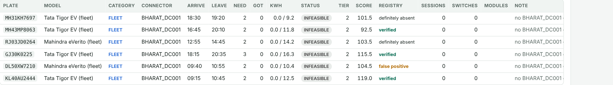

## 4. Performance charts and tables

Full results: `benchmarks/results.md` (median of 5 runs after 2 warm-ups, fixed seeds; reproduce with `./mvnw -q compile exec:java`).

### 4.1 Solution quality vs greedy baseline

| Vehicles | Modules | Edmonds–Karp slots | Greedy slots | Gain |
|---:|---:|---:|---:|---:|
| 250 | 14 | 333 | 313 | +6.4% |
| 1,000 | 56 | 1,415 | 1,343 | +5.4% |
| 2,000 | 112 | 2,863 | 2,710 | +5.6% |
| 4,000 | 224 | 5,667 | 5,308 | +6.8% |

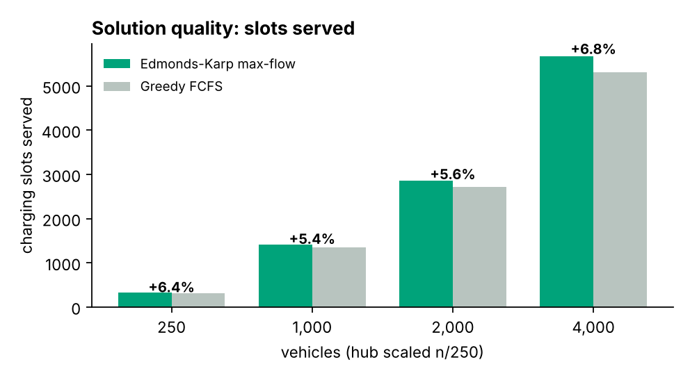

### 4.2 Running time as input grows

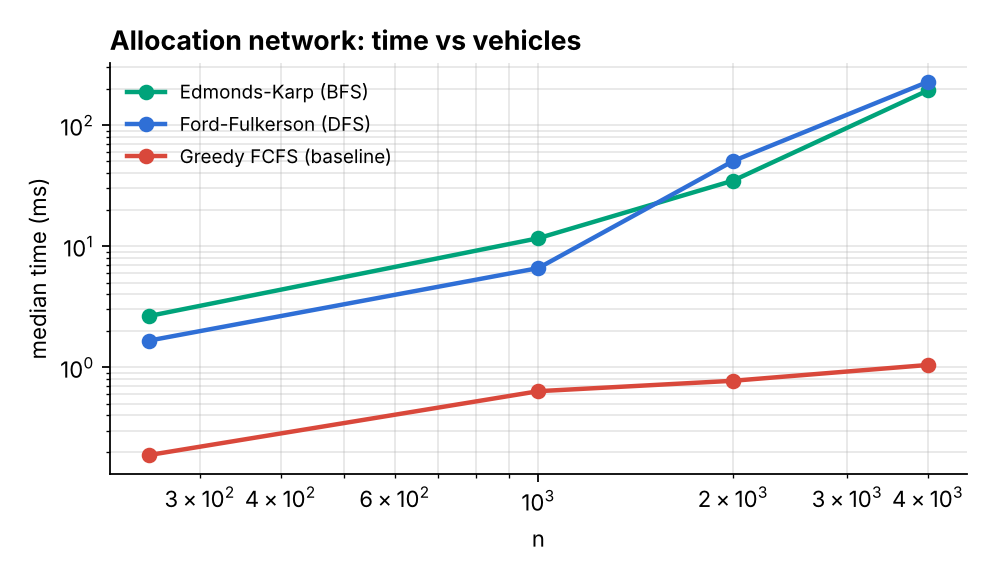

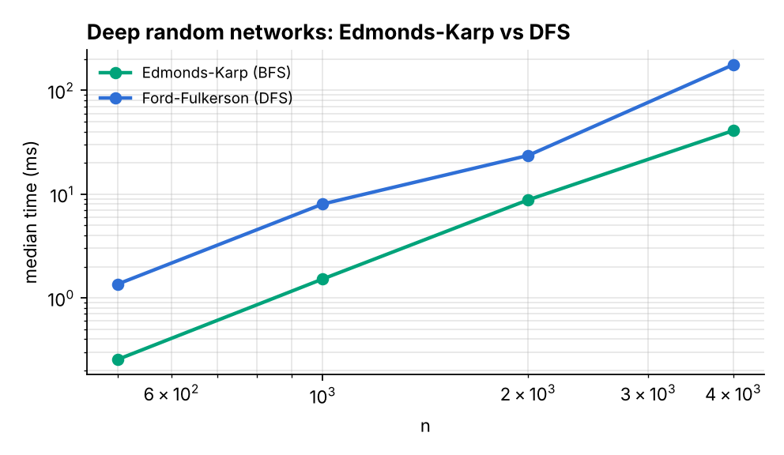

On deep networks with large capacities, Edmonds–Karp needs about 2.8× fewer augmenting paths and runs 2.7–5.3× faster than DFS Ford–Fulkerson (4,000 nodes: 41 ms vs 177 ms).

### 4.3 Randomized Quickselect vs baselines

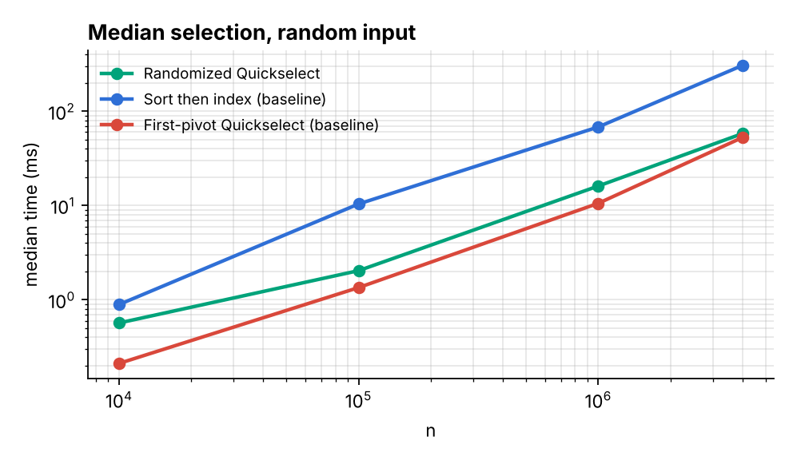

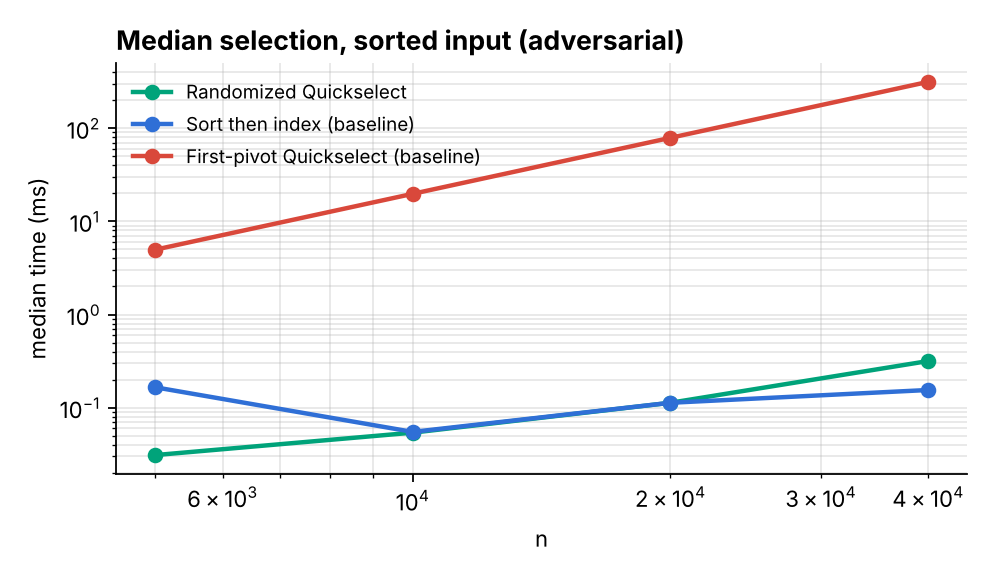

Randomized Quickselect is about 5× faster than sorting at 4M elements (58 ms vs 307 ms). On sorted input the first-pivot baseline grows quadratically (40k elements: 314 ms and 6×10⁸ comparisons, vs 0.3 ms and 2.4×10⁵ comparisons).

### 4.4 Bloom filter accuracy and memory

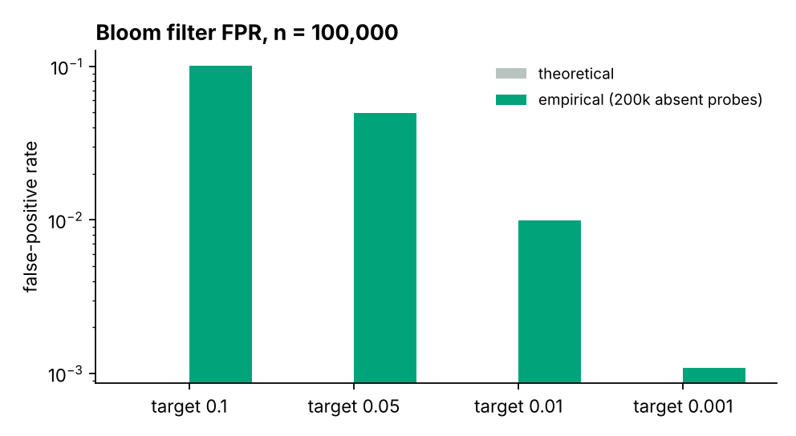

| Plates | Bloom memory | HashSet (est.) | Empirical FPR | Theoretical FPR |
|---:|---:|---:|---:|---:|
| 10,000 | 12 KB | 0.96 MB | 1.045% | 1.004% |
| 100,000 | 120 KB | 9.6 MB | 1.028% | 1.004% |
| 1,000,000 | 1.2 MB | 96 MB | 0.969% | 1.004% |

Zero false negatives were observed in every run.

### 4.5 Live benchmarks inside the app

The Benchmarks tab runs the same experiments on demand on the server and charts them.

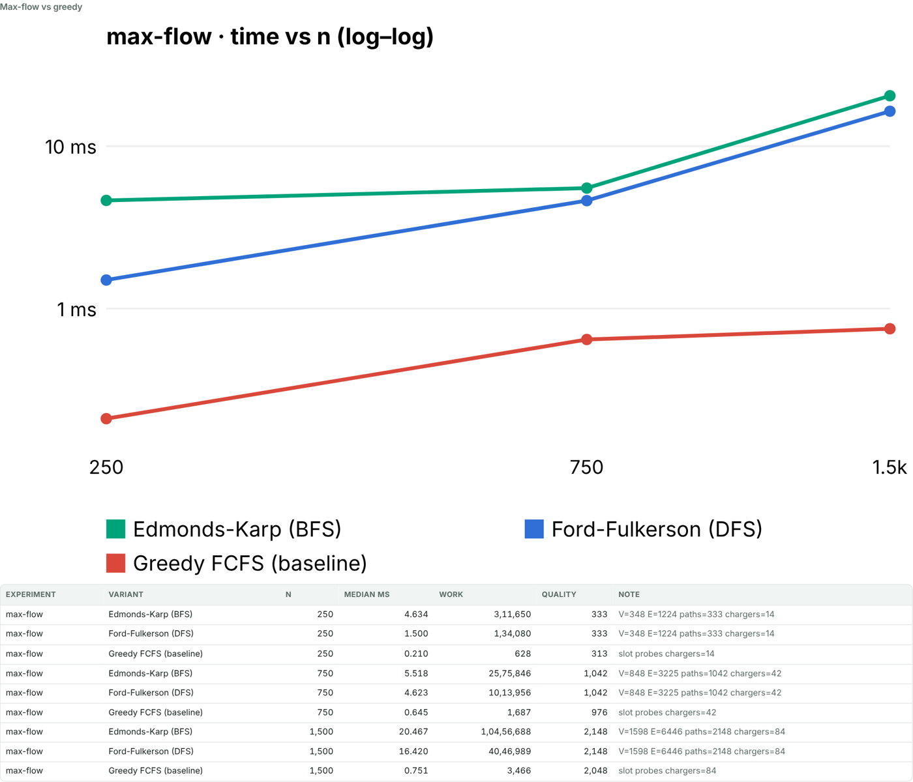
