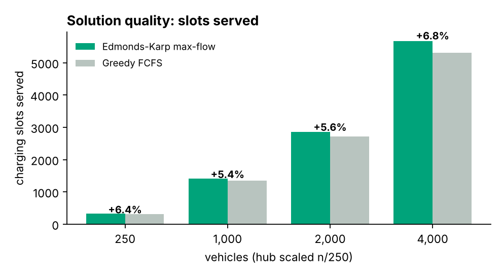
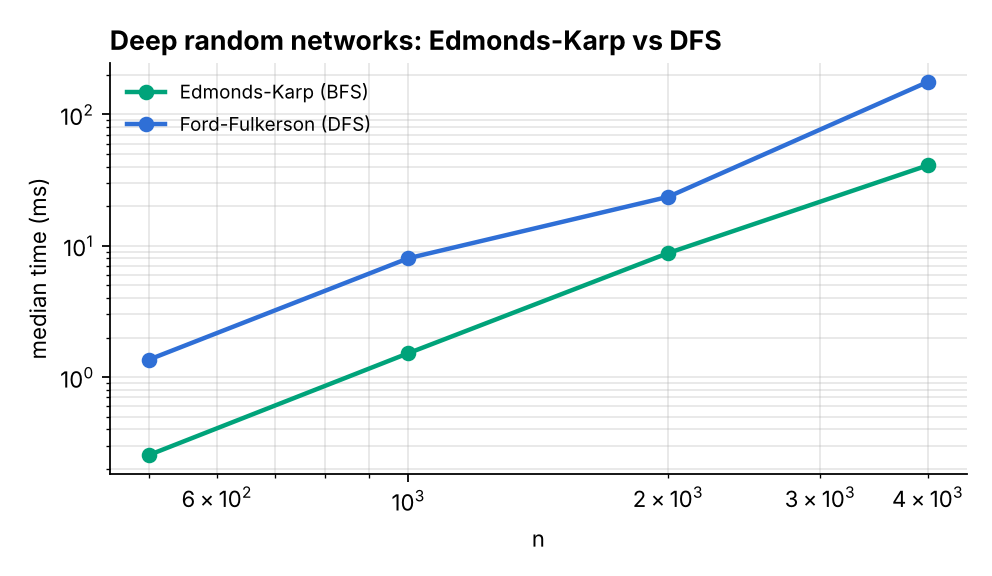
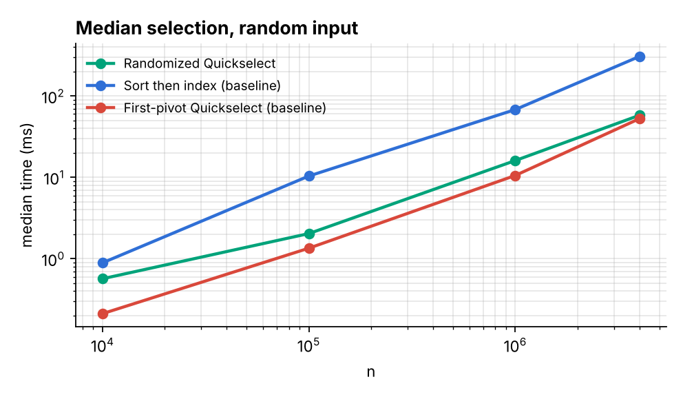
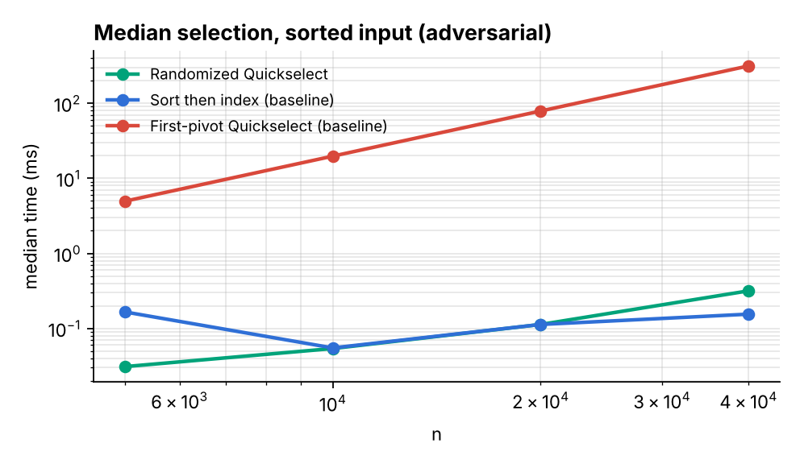
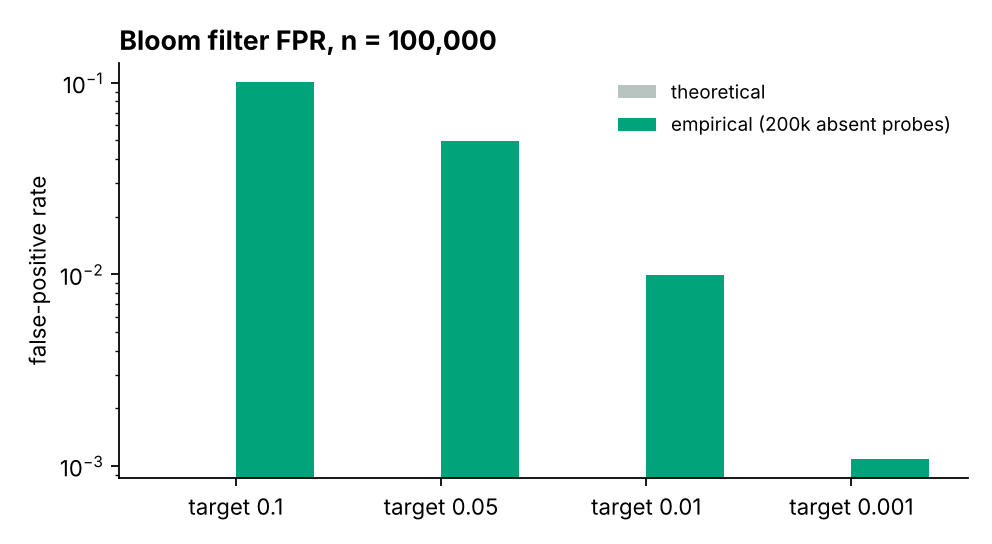

# ChargeFlow: Technical Report

**Advanced Algorithms · CIA-3 Real-World Application Project · Semester V, B.Tech CS (AI & ML), 2026–27**
Daksh Shah · App ID 2405709 · Atlas SkillTech University · individual submission

---

## 1. Problem statement and constraints

An urban EV charging hub owns **M charging modules**, each with one connector type c ∈ {CCS2, Type 2 AC, Bharat DC-001} and a rated power P_c. Its operating day is divided into **T slots** of length Δ (default 06:00–22:00, Δ = 30 min, T = 32). Some modules are down for maintenance in some slots. Over the day, **n vehicles** arrive. Vehicle v has a connector c(v), an arrival a_v and a departure d_v, a requested energy E_v, a maximum acceptance power, a state of charge and a category (emergency, fleet, private).

The hub uses **dynamic power sharing**: a vehicle stays in its bay for its whole stay, and the power cabinet switches modules between bays at slot boundaries. In each slot a vehicle is either charging on exactly one compatible module or idle.

**Derived quantities.** Effective power p_v = min(P_c(v), vehicle max). Each granted slot delivers p_v·Δ kWh. The vehicle needs r_v = ⌈E_v / (p_v·Δ)⌉ slots. Its usable window is the set of slots fully inside [a_v, d_v] ∩ opening hours, W_v = {⌈a_v⌉, …, ⌊d_v⌋−1}. Servable demand is D_v = min(r_v, |W_v|).

**Constraints.**
- (C1) In slot t, at most cap(c, t) vehicles of connector c charge, where cap(c, t) = number of modules of type c available at t.
- (C2) A vehicle charges in at most one module per slot, and only in slots of W_v.
- (C3) A vehicle receives at most D_v slots.

**Objectives.**
- (O1) Maximise total delivered slots Σ_v x_v (equivalently, delivered kWh at slot granularity).
- (O2) Lexicographically first maximise the slots of a **priority tier** (the top-k vehicles by priority score), then the rest.
- (O3) Explain the result: which (connector, slot) capacities bind.

**Supporting tasks.** Screen each plate against a large subscriber registry (subscribers earn a priority bonus), and report percentile statistics.

**Input limits enforced.** n ≤ 20,000; M ≤ 500; T ≤ 288; Δ ∈ [5, 240] min; energy ∈ (0, 200] kWh; SoC ∈ [0, 100]; valid Indian plates (standard or BH series); unique plates; departure > arrival.

## 2. System design

```
 Browser (HTML/CSS/JS, no build)                 Spring Boot (Java 17+)
 ┌──────────────────────────────┐   REST/JSON   ┌───────────────────────────────────────────────────────────┐
 │ Plan: hub editor, CSV upload,│ ────────────▶ │ api/ChargeFlowController ── api/ApiExceptionHandler       │
 │       generator, options     │               │        │                                                  │
 │ Results: KPIs, min-cut, heat │ ◀──────────── │ service/AllocationService (orchestration)                 │
 │   map, Gantt, vehicle table  │               │   ├─ ValidationService   (normalise, reject, warn)        │
 │ Registry: Bloom stats/check  │               │   ├─ RegistryService     (BloomFilter + exact store)      │
 │ Benchmarks: live charts      │               │   ├─ engine/PriorityTiering (RandomizedQuickselect)       │
 └──────────────────────────────┘               │   ├─ engine/AllocationEngine (FlowNetwork, EdmondsKarp,   │
                                                │   │      FordFulkersonDfs, MinCut, greedy baseline)       │
                                                │   └─ engine/ChargerAssigner (slot grants → module ids)    │
                                                │ data/SyntheticData, VehicleCsv · bench/Benchmarks, Cli    │
                                                └───────────────────────────────────────────────────────────┘
```

**Separation of concerns.** `algo.*` holds pure, framework-free algorithm classes (unit-tested in isolation). `engine.*` maps the domain to the algorithms. `service.*` handles validation, state and orchestration. `api.*` handles transport only. The frontend never computes allocations; it sends the hub, the vehicles and the options, and renders the JSON result.

**Allocation pipeline (`POST /api/allocate`).**
1. Validate and normalise → `VehicleRequest` (slots, window, demand, feasibility, notes).
2. Registry screening: Bloom filter, then exact lookup on hits.
3. Priority scores, then Quickselect threshold, then tiers.
4. Tiered max-flow (or the baseline), then min-cut.
5. Module assignment.
6. Result DTO: summary, baseline comparison, cut explanation, schedule grid, slot loads, per-vehicle outcomes, warnings.

**API.** `GET /api/hub/default`, `POST /api/hub/validate`, `POST /api/vehicles/generate`, `POST /api/vehicles/parse` (CSV), `POST /api/allocate`, `GET /api/registry`, `POST /api/registry/generate|load`, `GET /api/registry/check?plate=`, `GET /api/benchmark/{flow|selection|bloom|fpr}`. Errors use one schema `{status, error, details[], timestamp}`: 422 for domain validation (all problems listed), 400 for malformed input.

## 3. Flow model

```
              D_v                1                  cap(c,t)
   source ─────────▶ vehicle v ─────▶ (c(v), t) ──────────────▶ sink        for every t ∈ W_v with cap(c(v),t) > 0
```

Nodes: 2 + n + |C|·T. Edges: n source arcs + Σ_v |W_v| unit arcs + ≤ |C|·T sink arcs. For the 220-vehicle demo day this is 318 nodes and 1,036 edges.

**Claim.** Integral feasible flows of value F correspond exactly to slot-grant schedules that satisfy C1–C3 and deliver F slots.
*Proof.* Given an integral flow, unit arcs v→(c, t) carrying 1 are the granted slots. Conservation at v limits the grants to D_v (C3). The unit capacity means at most one grant per slot per vehicle (C2). Conservation at (c, t) and the sink capacity give at most cap(c, t) vehicles in slot t (C1). Conversely, any schedule defines such a flow. By the **integrality theorem**, Ford–Fulkerson with integer capacities returns an integral maximum flow, so a maximum flow is an optimal schedule for O1. ∎

## 4. Algorithms (own Java implementations)

### 4.1 Residual network (`FlowNetwork`)
Forward-star arrays (`head`, `next`, `to`, `capacity`, `residual`). Each `addEdge` creates arc e and its reverse e⊕1, so pushing x along e is `residual[e] -= x; residual[e^1] += x`. Nodes and edges can be added between solver runs, which the tiering relies on.

### 4.2 Edmonds–Karp with tiers (`EdmondsKarp`, `AllocationEngine.maxFlow`)
```
TIERED-MAXFLOW(hub, requests, tiers):
  build sink arcs (c,t)→T with cap(c,t); unit arcs v→(c(v),t) for t ∈ W_v
  for tier k = 1, 2, …:
      for v in tier k: add arc S→v with capacity D_v
      EDMONDS-KARP-AUGMENT(G, S, T)            // resumes from current flow
  decode: slots(v) = { t : flow(v→(c,t)) = 1 }
  cut = MIN-CUT(G, S)

EDMONDS-KARP-AUGMENT(G, s, t):
  loop:
     BFS from s over arcs with residual > 0, recording parentArc; stop when t is labelled
     if t unreached: return
     b = min residual along parentArc chain t→s
     for each arc e on the chain: residual[e] -= b; residual[e^1] += b
```
**Priority guarantee.** An augmenting path is a simple s–t path, so it uses exactly one arc leaving s, as a forward arc, and never a reverse arc into s. Augmentations in later phases therefore never reduce flow on earlier source arcs. When phase k ends there is no augmenting path, so the flow restricted to tiers 1..k is maximum for the network with only those source arcs. Tier 1 gets its standalone optimum, and the final flow is still a global maximum for all tiers, because the last phase runs Edmonds–Karp to completion on the full network. Asserted in tests via `tierServedAfterOwnPhase[0] == tierServed[0]`.

### 4.3 Min-cut (`MinCut`)
BFS from s in the final residual network gives S. The cut arcs are forward arcs with u ∈ S and v ∉ S. In ChargeFlow terms the cut splits into (a) source arcs of fully served vehicles and (b) saturated (connector, slot) sink arcs, the **binding capacity** that the heat-map outlines.

### 4.4 Bloom filter (`BloomFilter`, `RegistryService`)
```
optimal(n, p): m = ⌈−n ln p / (ln 2)²⌉ ; k = round((m/n) ln 2)
h1 = fmix64(FNV-1a64(key)) ; h2 = fmix64(seededMulHash(key)) | 1
add(key):    for i in 0..k−1: set bit (h1 + i·h2) mod m
query(key):  for i in 0..k−1: if bit (h1 + i·h2) mod m is 0 → DEFINITELY_ABSENT
             return POSSIBLY_PRESENT
CHECK(plate): if query = DEFINITELY_ABSENT → not a subscriber (no store access)
              else exact lookup → VERIFIED or FALSE_POSITIVE (caught, never trusted)
```
Bits are kept in a `long[]` with an incremental population count. Both hash functions are written from scratch. Kirsch–Mitzenmacher double hashing gives k probe positions from two hashes.

### 4.5 Randomized Quickselect (`RandomizedQuickselect`) and tiering
```
SELECT(A, k):   lo = 0, hi = n−1
  loop: if lo = hi return A[lo]
        p = A[uniform(lo..hi)]
        3-way partition A[lo..hi] → [<p | =p | >p] at indices lt..gt
        if k < lt: hi = lt−1  elif k > gt: lo = gt+1  else return p
TIER(requests, fraction):
  score_v = categoryWeight + 0.5(100 − SoC) + 30·min(1, r_v/|W_v|) + 10·[verified subscriber]
  k = ⌈fraction · #feasible⌉ ;  θ = SELECT(scores, n_f − k)          // k-th largest
  tier1 = {score > θ} ∪ first (k − |{score > θ}|) vehicles with score = θ ; tier2 = rest
```
The three-way partition keeps runs of tied scores linear. The tie rule gives exactly k vehicles in a deterministic way.

### 4.6 Module assignment (`ChargerAssigner`)
For t = 0..T−1: first, each vehicle granted slot t keeps its module from t−1 if that module is free. Then the remaining vehicles take the lowest-indexed free module of their type. C1 guarantees a free module exists, so the mapping always succeeds. The UI reports sessions and module switches.

### 4.7 Baselines
**Greedy FCFS:** tiers in order; inside a tier, by arrival; each vehicle takes the earliest free slots in its window. **Ford–Fulkerson DFS:** same residual graph, any augmenting path found by iterative DFS. **First-pivot Quickselect** (Lomuto). **Sort-then-index** (`Arrays.sort`). **HashSet** membership.

## 5. Correctness discussion

- **Max-flow optimality:** at termination no s–t path exists in G_f. The reachable set S defines a cut whose forward arcs are saturated and whose backward arcs carry no flow, so |f| = c(S, V∖S). Every flow is at most the capacity of every cut (weak duality), so no flow exceeds |f|: f is maximum and (S, V∖S) is a minimum cut (max-flow min-cut theorem). The app checks |f| = c(cut) on every run, and tests assert it on random graphs.
- **Termination:** each augmentation increases |f| by an integer ≥ 1, and |f| ≤ Σ D_v.
- **Bloom filter:** a key's k bits are set on insertion and never cleared, so there are no false negatives. False positives occur with probability ≈ (1 − e^{−kn/m})^k. Correctness of the *application* does not depend on that rate, because every positive is verified exactly.
- **Quickselect:** after partitioning, all elements of A[lt..gt] equal p and sit at their final sorted ranks. The recursion keeps the side that contains rank k, which is a loop invariant, so the returned value is the k-th order statistic.
- **Schedule validity:** follows from the flow ↔ schedule correspondence (§3) and the assignment argument (§4.6). Stress tests independently re-check C1–C3 on random days.

## 6. Complexity

| Component | Time | Space |
|---|---|---|
| Network build | O(n + Σ|W_v| + |C|T) | O(V + E) |
| Edmonds–Karp | O(VE²) worst case; here also O(E·|f*|), since every path carries ≥ 1 and |f*| ≤ min(ΣD_v, ΣCap) | O(V) extra |
| Ford–Fulkerson DFS | O(E·|f*|) (capacity-dependent; on general integer capacities it can need |f*| paths) | O(V) |
| Min-cut | O(V + E) | O(V) |
| Greedy baseline | O(n log n + Σ|W_v|) | O(|C|T) |
| Bloom build / query | O(n(k + L)) / O(k + L), L = key length | m bits = −n ln p/(ln 2)² (9.59 bits/key at 1%) |
| Randomized Quickselect | expected O(n), worst O(n²) with vanishing probability | O(1) extra (in place on a copy) |
| Tiering | O(n) expected | O(n) |
| Module assignment | O(T·(M + granted)) | O(M·T) |

**Why Edmonds–Karp here.** Its bound is independent of capacities. With many modules per type, cap(c, t) is large, and DFS can follow long residual detours. On the shallow allocation network (path length 3) both variants are cheap. §7 shows where the guarantee pays off.

**Tractability note (Unit 6).** Two natural variants are NP-hard: (i) maximising the *number of fully charged vehicles* (it contains 0/1 knapsack: one module, one slot window, demands = weights); (ii) requiring each vehicle's slots to be *contiguous* (scheduling with demand intervals). ChargeFlow solves the polynomial relaxation exactly (max-flow), reports fully-served counts honestly, and uses the assigner to keep sessions contiguous where possible.

## 7. Experimental evaluation

**Methodology.** `bench/BenchmarkCli` uses fixed seeds, 2 warm-up runs and the median of 5 timed runs. It records wall time and machine-independent work counters (arc scans, comparisons). The flow experiments scale the hub with n (n/250 × the default hub) so congestion stays comparable. Machine: OpenJDK 21, 2 vCPU Linux container (absolute times vary by machine; ratios and counters are the comparison). Full table: `benchmarks/results.md`. Reproduce with `./mvnw -q compile exec:java`.

### 7.1 Solution quality: max-flow vs greedy FCFS

| vehicles | modules | Edmonds–Karp slots | Greedy slots | gain | EK time | Greedy time |
|---:|---:|---:|---:|---:|---:|---:|
| 250 | 14 | 333 | 313 | **+6.4%** | 2.6 ms | 0.19 ms |
| 1,000 | 56 | 1,415 | 1,343 | **+5.4%** | 11.6 ms | 0.63 ms |
| 2,000 | 112 | 2,863 | 2,710 | **+5.6%** | 34.8 ms | 0.77 ms |
| 4,000 | 224 | 5,667 | 5,308 | **+6.8%** | 193 ms | 1.04 ms |



On the 220-vehicle demo day, max-flow delivers 325 vs 312 slots (+179.6 kWh) and fully charges **6 more vehicles** (137 vs 131), with identical tier-1 service. Greedy loses because early, long-stay arrivals take slots that later short-stay vehicles needed. Max-flow re-routes them through residual (reverse) arcs. **When it helps:** the gain grows with congestion and window heterogeneity. Under light load both methods serve all demand and greedy is fine. The price is milliseconds of extra compute, negligible for planning.

### 7.2 Edmonds–Karp vs Ford–Fulkerson (DFS)

| network | n | EK paths | DFS paths | EK ms | DFS ms |
|---|---:|---:|---:|---:|---:|
| allocation (depth 3) | 4,000 veh. | 5,667 | 5,667 | 193 | 227 |
| deep random, caps ≤ 10⁴ | 500 | 83 | 237 | 0.26 | 1.36 |
| deep random | 1,000 | 211 | 619 | 1.5 | 8.0 |
| deep random | 2,000 | 554 | 1,487 | 8.8 | 23.6 |
| deep random | 4,000 | 720 | 1,980 | 41.0 | 176.9 |



Both always return the same value (tested). On the allocation network every path has three arcs and each pushes one unit, so path counts are identical and DFS's cheaper search often wins (an honest negative result). On deep networks with large capacities, BFS shortest paths need **~2.8× fewer augmentations** and run **2.7–5.3× faster**. That is the regime of the theoretical guarantee, and why EK is the default when hubs are large.

### 7.3 Randomized Quickselect vs baselines (median, k = n/2)

| input | n | Randomized | Sort-then-index | First-pivot |
|---|---:|---:|---:|---:|
| random | 10⁶ | 16.1 ms | 68.1 ms | 10.6 ms |
| random | 4·10⁶ | **58.0 ms** | 306.8 ms | 52.8 ms |
| sorted | 10⁴ | 0.05 ms (3.1·10⁴ cmp) | 0.06 ms | 19.7 ms (3.8·10⁷ cmp) |
| sorted | 4·10⁴ | **0.32 ms** (2.4·10⁵ cmp) | 0.16 ms | **314 ms** (6.0·10⁸ cmp) |

 

Randomized Quickselect is **4–5× faster than sorting** at large n, and its comparisons per element stay bounded (≈3–6.5n across 10⁴–4·10⁶). The deterministic first-pivot version is slightly faster on random data (no RNG) but grows **quadratically on sorted input**: 4× more data costs 16× more time. Ranked score lists are often nearly sorted, so randomisation is the right choice. (`Arrays.sort` detects sorted runs, which is why it is fast on sorted input.)

### 7.4 Bloom filter vs exact set (target FPR 1%)

| n plates | m bits | k | Bloom memory | HashSet (est.) | empirical FPR | theoretical |
|---:|---:|---:|---:|---:|---:|---:|
| 10,000 | 95,851 | 7 | 12 KB | 0.96 MB | 1.045% | 1.004% |
| 100,000 | 958,506 | 7 | 120 KB | 9.6 MB | 1.028% | 1.004% |
| 1,000,000 | 9,585,059 | 7 | 1.2 MB | 96 MB | 0.969% | 1.004% |



The FPR sweep at n = 10⁵ (targets 10%, 5%, 1%, 0.1%) measured 10.10%, 4.99%, 0.99% and 0.109%, with **zero false negatives** in every run. The filter is about **80× smaller** than a HashSet. In-process, a HashSet query is ~3–5× faster (one hash vs k probes), so the Bloom filter is *not* a speed-up over local memory. Its value is that the exact store sits behind a network or disk. In the demo it avoided 141 of 220 exact lookups (64%), and the 2 false positives it produced were caught by verification and **not** credited as subscriptions.

## 8. Testing

60 JUnit 5 tests (`./mvnw test`, all passing): **MaxFlowTest (18)**, BloomFilterTest (7), QuickselectTest (11), AllocationEngineTest (11), ValidationAndRegistryTest (8), ApiIntegrationTest (5). Every core algorithm has at least 5 correctness tests, including edge or boundary cases:

- **Flow:** sink unreachable, zero/single edge, parallel and anti-parallel arcs, cancellation through reverse arcs, invalid s = t; random property checks for conservation, capacity, EK = FF and |f| = min-cut.
- **Bloom:** empty filter, null key, sizing formula, FPR within 25% of theory over 200k probes, overfill.
- **Quickselect:** every k on arrays with duplicates, k = 0 and k = n−1, all-equal arrays (linear work), empty input and NaN, sorted adversary.
- **Domain:** a hand-checked greedy trap (greedy 1 slot vs max-flow 2), demand > window, missing connector, maintenance, tier preservation, randomized stress invariants.
- **API:** 422 and 400 paths.

**Hand-checked instance** (`sample-data/hub_small.json`): greedy serves 5 slots and fully charges 3 vehicles; Edmonds–Karp serves 7 and fully charges 5, equal to the min-cut of 7 (see README §6).

## 9. Limitations

1. Optimises slots/energy, not the count of fully charged vehicles (NP-hard; reported, not optimised).
2. Non-contiguous charging is allowed (the power-sharing model); strict contiguity is NP-hard.
3. Slot-level energy model: no charging taper, no partial slots, single connector per vehicle.
4. Single-day, deterministic arrivals: no no-shows or online re-planning (a rolling-horizon re-run is the natural extension, and resuming augmentation already supports adding vehicles incrementally).
5. Synthetic data: realistic distributions, but not a real operator log. The authoritative registry is in-memory.
6. Benchmarks ran on a shared 2-vCPU container; wall times are noisy, so work counters are reported alongside.

## 10. Individual contribution

This is an individual project (faculty-approved). Daksh Shah is responsible for the problem formulation, the flow model and tiering design, all Java algorithm implementations (`algo.*`), the domain engine, the REST API, the frontend, the data generator, the tests, the benchmarks and this report.

*Tools and assistance:* Spring Boot (HTTP/JSON only), JUnit 5, and matplotlib (report charts). AI assistance (Claude) was used during development for code generation, review and drafting of documentation.
